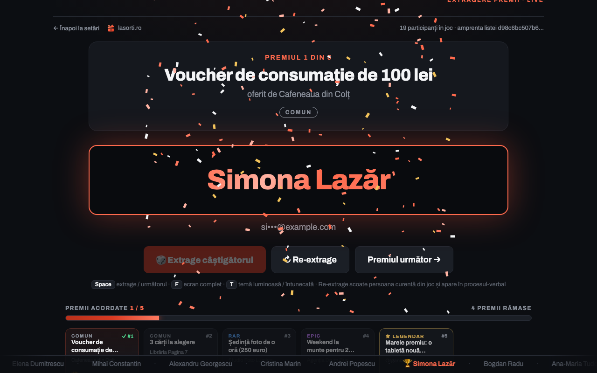

# la sorți · lasorti.ro

[](https://github.com/razvanstan/lasorti/actions/workflows/ci.yml) [](LICENSE)

A free, ad-free tool for drawing winners live, at events or for social media giveaways.
**Participants' data never leaves the browser.** The interface is in Romanian.

🌐 https://lasorti.ro · 🎲 [Demo](https://lasorti.ro/demo/) · 📖 [How it works](https://lasorti.ro/cum-functioneaza/) (in Romanian)

> **Pe scurt, în română:** instrument gratuit, fără reclame și fără cont, pentru tombole și giveaway-uri.
> Lipești lista de participanți sau comentariile, pornești extragerea pe ecranul mare și obții un proces-verbal.
> Datele rămân în browserul tău. Îl folosești direct pe [lasorti.ro](https://lasorti.ro).



## Features

- **Tombola:** several prizes with sponsors and rarities; participants pasted from Excel, Google Sheets or Forms, with a choice of unique field (email, phone, name or any column) and of one or several prizes per person.
- **Giveaway:** winners and reserves from comments copied from Instagram or from a list of participants, with rules (minimum tags, required keyword, excluded accounts, one chance per person or per comment).
- **Quick tools:** a wheel of options, random teams and random order; repeated draws of the same list are labelled.
- A stage for the big screen: countdown, suspense, confetti, sounds, full screen (`F`), `Space` to draw.
- Redraws for absent winners, recorded in the printable report.
- Draws resume after a page reload, and a winner already chosen cannot be changed by reloading.
- SHA-256 fingerprint of the participant list, so that anyone can verify it.
- A picture of the winners for social media, made in the browser.
- Exports: spreadsheet, CSV, printable report, exact participant list, `.json` configuration.
- Custom title, logo and accent colour; light and dark mode.

## Fairness and privacy

- **Random choice:** `crypto.getRandomValues`, with rejection sampling to avoid modulo bias ([`random.ts`](src/scripts/random.ts)). Everyone still in the draw has the same chance, unless the organiser gives one per valid comment.
- **The animation decides nothing:** the winner is chosen, and saved, before the names start spinning. Reloading the page cannot change it.
- **What the fingerprint proves:** the SHA-256 of the [canonical list](src/scripts/people.ts) shows that the list was not changed. It does not prove how the tool was used: the draw runs on the organiser's computer, so redraws are written in the report, and important draws should have a witness.
- **No backend:** lists, settings and progress stay in `localStorage`. The site sets no cookies and loads nothing from other domains. The only requests it makes elsewhere are cookie-free counts of page views and draws started or ended, without any data from the tool, to a self-hosted Umami ([`stats.ts`](src/scripts/stats.ts)). The Content-Security-Policy in [`.htaccess`](public/.htaccess) blocks every other destination; the hashes of inline scripts are filled in at build time ([`csp.mjs`](integrations/csp.mjs)).

## Development

Requires Node 22.12 or newer.

```bash
npm install
npm run dev       # http://localhost:4321
npm test          # unit tests and full draws in jsdom
npm run check     # TypeScript and Astro
npm run lint
npm run format
npm run build     # static site in dist/
```

[Astro](https://astro.build) with static output, TypeScript and plain CSS; no framework at runtime.
Code and comments are in English, texts shown to users are in Romanian.

| Path                                                              | What it holds                                           |
| ----------------------------------------------------------------- | ------------------------------------------------------- |
| `src/components/DrawApp.astro`                                    | markup of the tool (setup and stage)                    |
| `src/scripts/draw.ts`                                             | entry point: flow of a draw, buttons, keyboard          |
| `src/scripts/kind.ts`                                             | what a draw type has to define                          |
| `src/scripts/tombola.ts`, `giveaway-kind.ts`                      | the two draw types                                      |
| `src/scripts/people.ts`, `prizes.ts`, `giveaway.ts`               | parsing and rules (pure functions)                      |
| `src/scripts/random.ts`                                           | choosing the winner                                     |
| `src/scripts/quick.ts`, `quick-draw.ts`                           | random teams and order                                  |
| `src/scripts/wheel.ts`, `wheel-motion.ts`, `wheel-draw.ts`        | the wheel                                               |
| `src/scripts/quick-store.ts`                                      | what the quick tools save, count and share between tabs |
| `src/scripts/draw-state.ts`                                       | state of a draw, saved in the browser                   |
| `src/scripts/stage-view.ts`, `spin.ts`, `confetti.ts`, `sound.ts` | what happens on stage                                   |
| `src/scripts/results.ts`, `report.ts`                             | exports and the printable report                        |
| `src/pages/`                                                      | the site                                                |
| `integrations/csp.mjs`                                            | Content-Security-Policy, filled in at build time        |
| `src/scripts/share-image.ts`, `share-panel.ts`                    | the picture for social media                            |
| `src/scripts/stats.ts`                                            | cookie-free counts of visits                            |
| `scripts/`                                                        | deploy and brand files                                  |
| `tests/`                                                          | tests                                                   |

`localStorage` keys, the configuration format and the canonical participant list are contracts with existing users: changing them breaks saved draws or published fingerprints.

## Contributing

Bug reports and ideas are welcome as [issues](https://github.com/razvanstan/lasorti/issues). Samples of comments that are not read correctly help most: **replace names, accounts, emails and phone numbers first.**

For a pull request, keep it to one change, add a test, and make sure that everything CI runs passes: `format:check`, `lint`, `check`, `test` and `build`.

## Brand

The symbol and palettes are defined once, in `src/brand/mark.mjs`. `npm run brand` generates everything else: logos and symbols in `public/brand/`, the favicon, app icons and the share image. The logo text is Archivo ExtraBold, converted to outlines.

## Deploy

The site works on any static hosting (build: `npm run build`, output: `dist`). For shared hosting over FTPS:

```bash
cp .env.example .env       # fill in the FTP details; the file is ignored by git
npm run deploy:check       # test the connection; changes nothing
npm run deploy:dry         # show what would be uploaded and deleted; changes nothing
npm run deploy             # build, upload, delete old files
npm run deploy -- --backup # the same, after downloading what is on the server
```

The remote folder is never emptied, files managed by the hosting (such as `.well-known/`) are never touched, and the script refuses to run on the home folder of a hosting account.

## License

[MIT](LICENSE) © Răzvan Stan · [razvanstan.ro](https://razvanstan.ro)

The license covers the code. The name „la sorți”, the logo and the lasorti.ro domain are not included: if you publish your own version, give it another name and logo. The Archivo font is under the [SIL Open Font License](https://openfontlicense.org).
